

<a href="https://shreyshrivastava.com"></a>

<a href="https://shreyshrivastava.com/index.html#about">About</a> · <a href="https://shreyshrivastava.com/projects.html">Projects</a> · <a href="https://shreyshrivastava.com/experience.html">Experience</a> · <a href="https://shreyshrivastava.com/education.html">Education</a> · <a href="https://shreyshrivastava.com/contact.html">Contact</a>

    

I’m an AI/ML engineer. I build systems that take a model out of a notebook and into something people can use, covering search, classification, forecasting and detection, plus the testing and deployment around them.

I have an MSc in Artificial Intelligence from Queen Mary University of London.

### Current focus

Making models useful to real people: paper search, medical data pipelines, scam detection, on-device sensing and a local coding agent.

## `01 /` Projects

Each project says what it set out to fix, how I built it and what came out, with links to the code and demos.

<table>
<tr>
<td width="50%" valign="top">
<a href="https://github.com/shreyshrivastava/AcademicForge">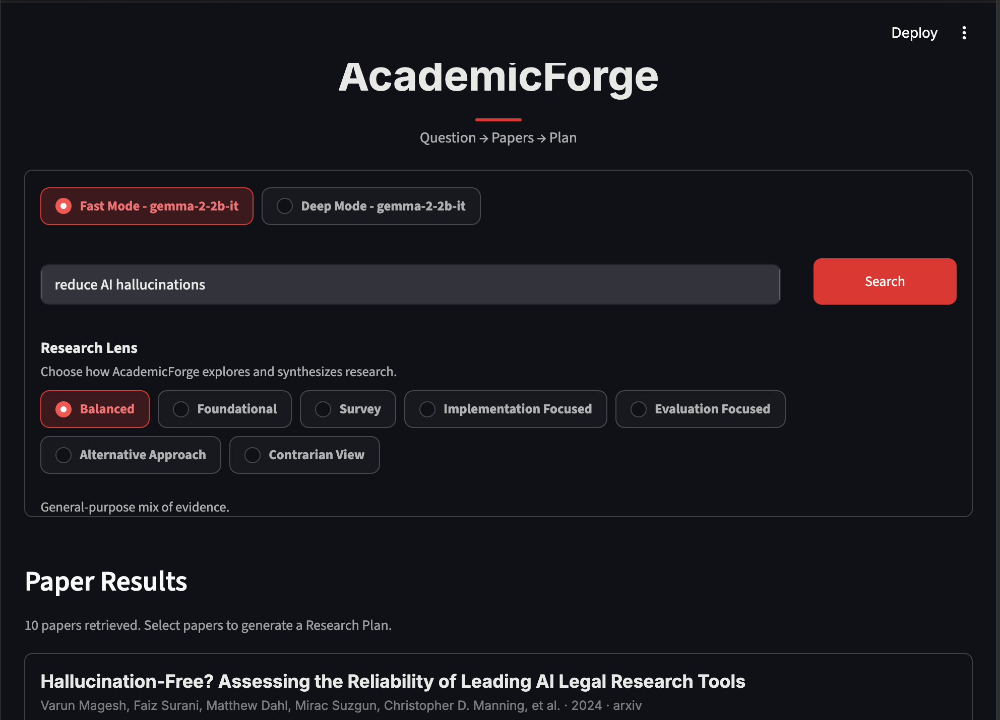</a>
<h3>01 · AcademicForge</h3>

<b>The problem.</b> Going from a research question to a plan means searching several paper sources, skimming dozens of abstracts and then writing the plan yourself.

<b>What I built.</b> A search over arXiv and Semantic Scholar that ranks papers by keywords and by meaning. You pick the papers you trust, and it summarises each one and builds a research plan from only those. A local Gemma model does the writing by default, so nothing has to leave your machine.

<b>What came out.</b> Built for the AMD hackathon and tested on Apple Silicon, NVIDIA and AMD ROCm. A lightweight demo mode runs with no API keys.

<code>RETRIEVAL</code> <code>RESEARCH</code>

<a href="https://github.com/shreyshrivastava/AcademicForge">Explore repository ↗</a>

</td>
<td width="50%" valign="top">
<a href="https://github.com/shreyshrivastava/ai-healthcare-intel-engine">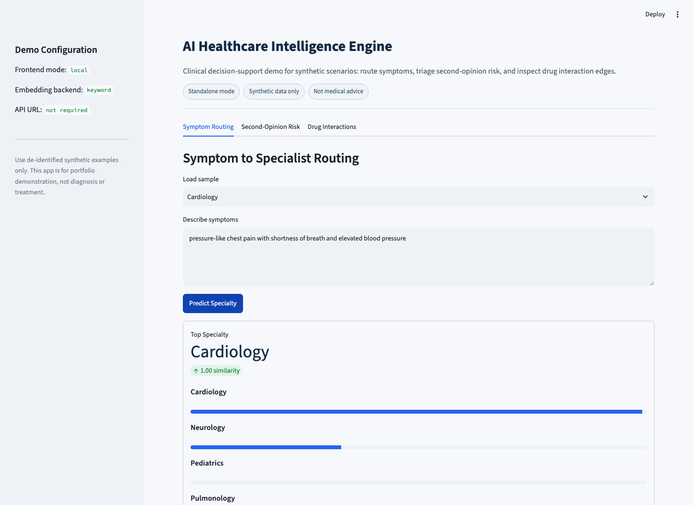</a>
<h3>02 · Healthcare intel</h3>

<b>The problem.</b> Healthcare AI demos often overclaim, and lean on an opaque model for every decision.

<b>What I built.</b> A demo with three tools: ranking likely specialists from symptoms, a second-opinion risk check, and a drug-interaction lookup. It runs on synthetic data with plain deterministic rules by default, and a sentence-embedding model is optional.

<b>What came out.</b> It is deployed as a live demo with tests running in CI. It is a portfolio project, not a medical device and not medical advice.

<code>HEALTHCARE AI</code> <code>DECISION SUPPORT</code>

<a href="https://github.com/shreyshrivastava/ai-healthcare-intel-engine">Explore repository ↗</a> · <a href="https://healthcare-intel-engine-shrey.streamlit.app/">Open live demo ↗</a>

</td>
</tr>
<tr>
<td width="50%" valign="top">
<a href="https://github.com/shreyshrivastava/claim-detection-project-on-Russia-and-conflict">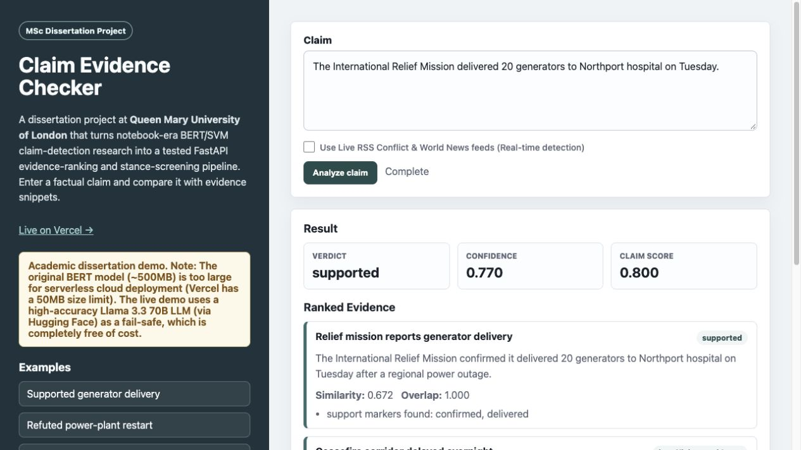</a>
<h3>03 · Evidence &amp; claims</h3>

<b>The problem.</b> News about the conflict is full of claims, and checking them by hand does not scale.

<b>What I built.</b> My MSc dissertation at Queen Mary. I turned an experimental BERT and SVM notebook into a FastAPI app that screens claims, retrieves evidence and gives a coarse stance. It falls back through four modes, down to simple rules, so it never crashes.

<b>What came out.</b> A live demo runs on Vercel. The cloud demo uses a hosted Llama model, because the original BERT model is too large for serverless. It is not a production fact-checker.

<code>NLP</code> <code>EVIDENCE RANKING</code>

<a href="https://github.com/shreyshrivastava/claim-detection-project-on-Russia-and-conflict">Explore repository ↗</a> · <a href="https://claim-detection-project.vercel.app/">Open live demo ↗</a>

</td>
<td width="50%" valign="top">
<a href="https://github.com/shreyshrivastava/pupil-anomaly-detection">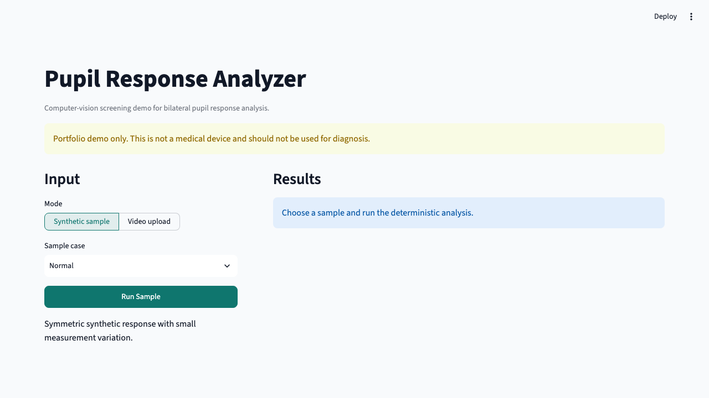</a>
<h3>04 · Pupil response analysis</h3>

<b>The problem.</b> Comparing how the left and right pupils react is subjective when done by eye.

<b>What I built.</b> A tool that measures the pupil radius of each eye from video with MediaPipe, compares the two over time, flags sudden jumps, and produces a score and a PDF report.

<b>What came out.</b> A live demo runs on Render with synthetic samples. It is a screening demo, not a diagnosis.

<code>COMPUTER VISION</code> <code>ANALYSIS</code>

<a href="https://github.com/shreyshrivastava/pupil-anomaly-detection">Explore repository ↗</a> · <a href="https://pupil-response-analyzer.onrender.com">Open live demo ↗</a>

</td>
</tr>
<tr>
<td colspan="2" valign="top">
<a href="https://github.com/shreyshrivastava/bhopal-crime-safety-intelligence">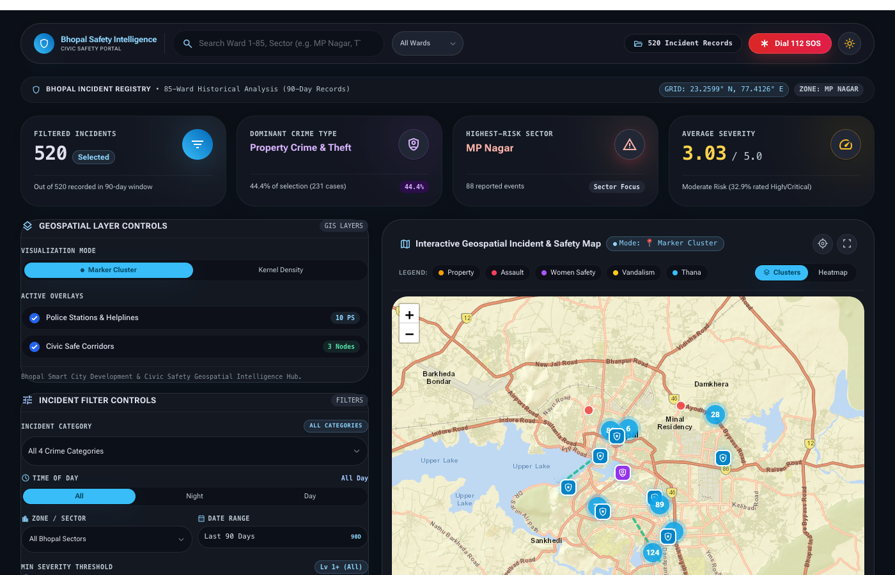</a>
<h3>05 · Bhopal Safety Intelligence</h3>

<b>The problem.</b> Bhopal Police publish crime and enforcement reports as separate press posts, so it is hard to see where they cluster. Dashboards that fill the gaps tend to invent data.

<b>What I built.</b> A map dashboard built from nine locatable police publications from April to October 2026, each checked by hand against the source text. Pins are approximate locality references, and each popup links to the official post. It also maps 48 police facilities and exports CSV with sources and missing values kept.

<b>What came out.</b> It shows what has been publicly reported and no more. There are no risk scores or density heatmaps, because the data cannot support them, and a category with no record reads as nothing loaded, not zero crime.

<code>GEOSPATIAL</code> <code>STREAMLIT</code> <code>LEAFLET</code> <code>MOBILE-FRIENDLY</code>

<a href="https://github.com/shreyshrivastava/bhopal-crime-safety-intelligence">Explore repository ↗</a> · <a href="https://bhopalcrimesafety.streamlit.app/">Open live demo ↗</a>

</td>
</tr>
</table>

### Also built

- [**agent-ops**](https://github.com/shreyshrivastava/agent-ops): a small terminal coding agent for a local model that shows every change and command and asks first.
- [**Agentic Honeypot**](https://github.com/shreyshrivastava/agentic-honeypot): flags likely scam messages and pulls out the payment details.
- [**ATS Resume Checker**](https://github.com/shreyshrivastava/ats-resume-checker): scores a resume against a job post with plain rules, so the score is the same every time.
- **FallGuard AI**: an IBM hackathon fall-detection app that runs on the phone itself (a team project).
- [**Local Lore Generator**](https://github.com/shreyshrivastava/local-lore-generator): writes regional Indian fables, with a [live demo](https://huggingface.co/spaces/shrey2105/local-lore-generator).

The full list is on [my website](https://shreyshrivastava.com/projects.html).

---

## `02 /` How I build

- **Rules first, model second.** In the resume checker, the healthcare demo and the honeypot, the score or decision comes from plain rules. A model only explains or assists, so the answer is the same every run.
- **Limits next to results.** Each project says what it does not do. The Bhopal map shows no risk scores, the arbitrage bot places no trades, and the claim checker is not a fact-checker.
- **Small samples called small.** agent-ops ran 8 tasks twice each and says so. The numbers are a rough guide, not a claim.

---

## `03 /` Tech stack





---

## `04 /` Education


[Queen Mary University of London](https://www.qmul.ac.uk/) · [Symbiosis University of Applied Sciences](https://www.suas.ac.in/)

---

## `05 /` Build log · Recent updates

What I’ve been working on lately, pulled from my own commit messages in my public repos. Each line links to the change.

<!-- RECENT-COMMITS:START -->
- **2026-11-05** — Merge pull request \#5 from shreyshrivastava/redesign-humanize · [AcademicForge](https://github.com/shreyshrivastava/AcademicForge) · [view commit](https://github.com/shreyshrivastava/AcademicForge/commit/684ecb3940a0bce72dcd33728f4d6793cdc7acb3)
- **2026-11-05** — Mark each step in the demo video and tidy plan citations · [AcademicForge](https://github.com/shreyshrivastava/AcademicForge) · [view commit](https://github.com/shreyshrivastava/AcademicForge/commit/2ccf358773749ca1a9346baa3b6cabc2cde13994)
- **2026-11-05** — Show plan citations, restore benchmarks section, fix demo link · [AcademicForge](https://github.com/shreyshrivastava/AcademicForge) · [view commit](https://github.com/shreyshrivastava/AcademicForge/commit/f6e0a3d6deec49f7dd04738faf8b6d6934212af1)
- **2026-11-05** — Merge pull request \#4 from shreyshrivastava/redesign-humanize · [AcademicForge](https://github.com/shreyshrivastava/AcademicForge) · [view commit](https://github.com/shreyshrivastava/AcademicForge/commit/5be3060ab8d53ba9b652231a66e5840df5109d3d)
- **2026-11-05** — Show the demo video in the README and keep only the faithfulness check · [AcademicForge](https://github.com/shreyshrivastava/AcademicForge) · [view commit](https://github.com/shreyshrivastava/AcademicForge/commit/326b55f8a13607b6c7260c448260952b84733ed6)
<!-- RECENT-COMMITS:END -->

### Active repositories

<!-- RECENT-REPOS:START -->
- [shreyshrivastava](https://github.com/shreyshrivastava/shreyshrivastava) — Config files for my GitHub profile.
- [AcademicForge](https://github.com/shreyshrivastava/AcademicForge) — Hackathon research assistant with paper search, summaries, guidance, and a cost-controlled Streamlit demo with request limiting.
- [shreyshrivastava.github.io](https://github.com/shreyshrivastava/shreyshrivastava.github.io) — Explore the repository and its latest changes.
- [bhopal-crime-safety-intelligence](https://github.com/shreyshrivastava/bhopal-crime-safety-intelligence) — Interactive geospatial crime mapping, police proximity analysis, and civic safety intelligence dashboard for Bhopal, MP
- [agent-ops](https://github.com/shreyshrivastava/agent-ops) — A coding agent that runs on your laptop with a local model \(Ollama\) and asks before every file change or command.
<!-- RECENT-REPOS:END -->

---

This section refreshes by itself every hour through a <a href=".github/workflows/update-readme.yml">GitHub Action</a>, and you can also run it from the Actions tab. New commits can take a little while to show up, and only public repos and commits from my own account are included.

---

### Say hello

**If any of this is close to what you work on, write to me.** I’m happy to talk through how any of these projects was built, what went wrong, and what I would change. That includes hiring for AI/ML engineering, healthcare ML, search, or agents you can supervise.

[Send email](mailto:shrey.shrivastava@yahoo.com) · [LinkedIn](https://www.linkedin.com/in/shrey-shrivastava1) · [GitHub](https://github.com/shreyshrivastava) · [ORCID](https://orcid.org/0000-0001-5273-2842)

<a href="https://shreyshrivastava.com/contact.html"></a>
