

<a href="https://shreyshrivastava.com"></a>

<a href="https://shreyshrivastava.com/index.html#about">About</a> · <a href="https://shreyshrivastava.com/projects.html">Projects</a> · <a href="https://shreyshrivastava.com/experience.html">Experience</a> · <a href="https://shreyshrivastava.com/education.html">Education</a> · <a href="https://shreyshrivastava.com/contact.html">Contact</a>

    

Hi, I’m Shrey - an AI Engineer who loves turning ideas into systems people can actually use. I care about a model holding up in the real world, where things break, edge cases show up, and trust matters. When I’m not building, you’ll usually find me reading a new paper and asking, “How would I actually ship this?” Always happy to connect, talk shop, or hear about what you’re building.

### Current focus

Agentic AI systems, retrieval-augmented LLM applications, and healthcare ML — building tools that go from research to something deployable.

## `01 /` Projects

My work spans agentic AI, retrieval-augmented LLM systems, healthcare ML, and evidence analysis. The previews below are actual application screenshots; click a project to explore its code.

<table>
<tr>
<td width="50%" valign="top">
<a href="https://github.com/shreyshrivastava/AcademicForge">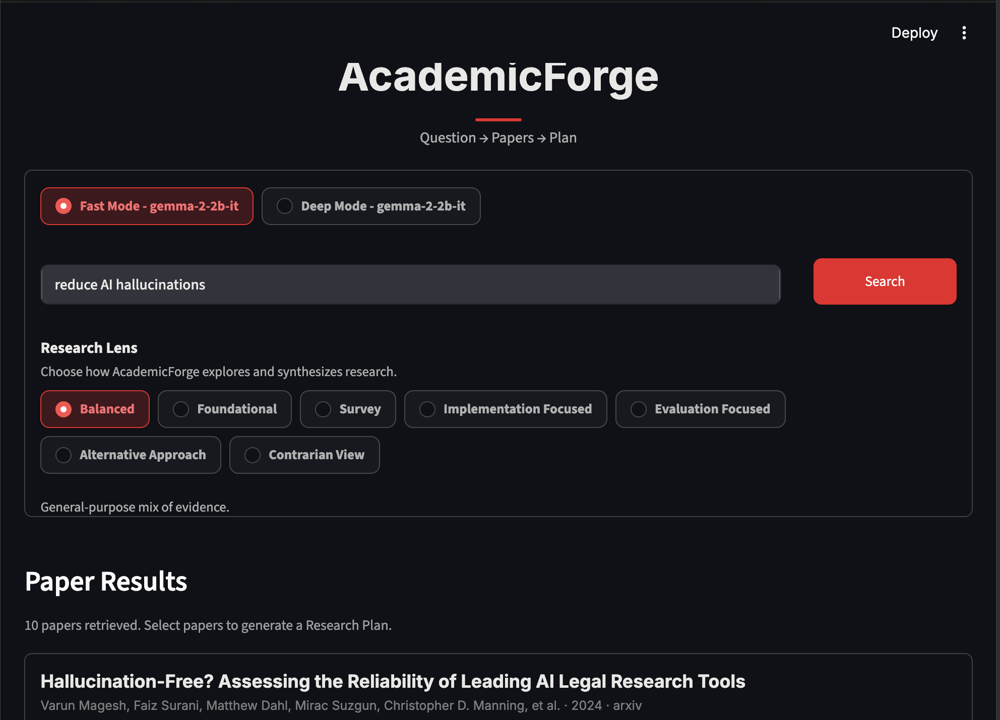</a>
<h3>01 · AcademicForge</h3>

Paper search, summaries, and research guidance in a cost-controlled Streamlit demo.

<code>RETRIEVAL</code> <code>RESEARCH</code>

<a href="https://github.com/shreyshrivastava/AcademicForge">Explore repository ↗</a>
</td>
<td width="50%" valign="top">
<a href="https://github.com/shreyshrivastava/ai-healthcare-intel-engine">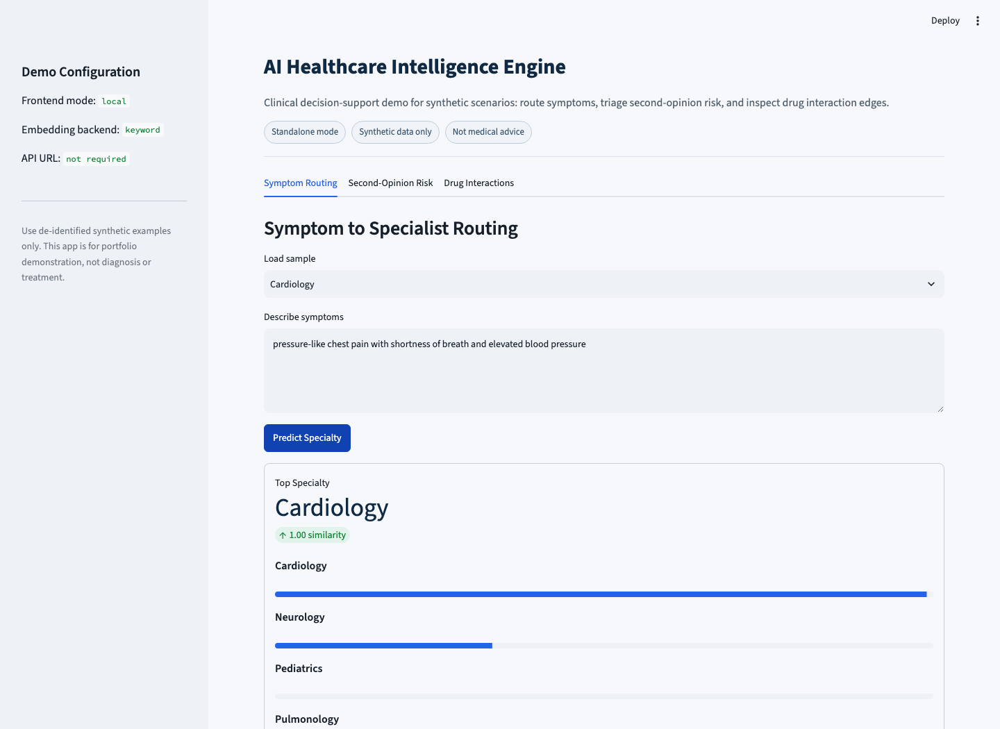</a>
<h3>02 · Healthcare intel</h3>

Symptom triage, second-opinion risk checks, and drug-interaction screening in a healthcare AI demo.

<code>HEALTHCARE AI</code> <code>DECISION SUPPORT</code>

<a href="https://github.com/shreyshrivastava/ai-healthcare-intel-engine">Explore repository ↗</a>
</td>
</tr>
<tr>
<td width="50%" valign="top">
<a href="https://github.com/shreyshrivastava/claim-detection-project-on-Russia-and-conflict">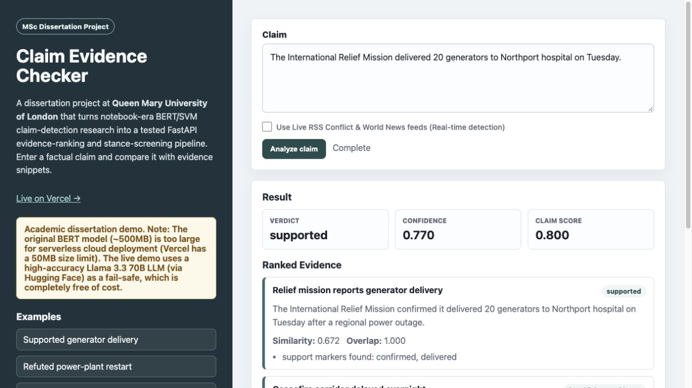</a>
<h3>03 · Evidence &amp; claims</h3>

MSc dissertation at Queen Mary University of London: a tested FastAPI pipeline for evidence ranking and stance screening.

<code>NLP</code> <code>EVIDENCE RANKING</code>

<a href="https://github.com/shreyshrivastava/claim-detection-project-on-Russia-and-conflict">Explore repository ↗</a>
</td>
<td width="50%" valign="top">
<a href="https://github.com/shreyshrivastava/pupil-anomaly-detection">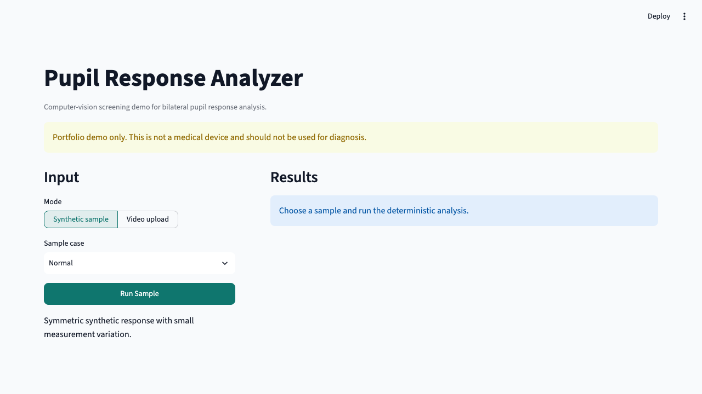</a>
<h3>04 · Pupil response analysis</h3>

Bilateral pupil-response scoring, anomaly detection, report generation, and a Dash demo.

<code>COMPUTER VISION</code> <code>ANALYSIS</code>

<a href="https://github.com/shreyshrivastava/pupil-anomaly-detection">Explore repository ↗</a>
</td>
</tr>
<tr>
<td colspan="2" valign="top">
<a href="https://github.com/shreyshrivastava/bhopal-crime-safety-intelligence">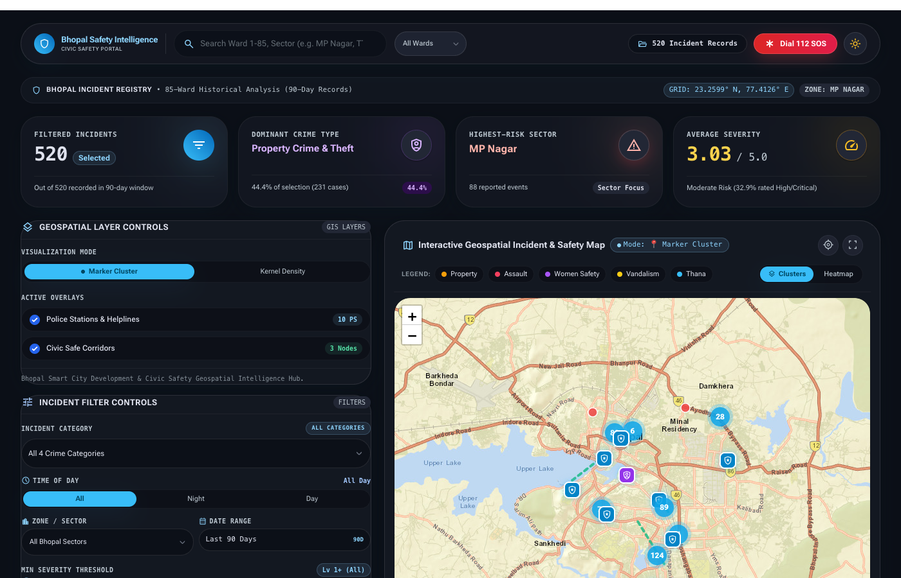</a>
<h3>05 · Bhopal Safety Intelligence</h3>

A mobile-friendly civic safety dashboard for Bhopal with interactive crime maps, police-station proximity analysis, publication-based locality charts, and safe-corridor overlays. Built on 10 reviewed official Bhopal Police publications, with a daily source-validated refresh.

<code>GEOSPATIAL ANALYTICS</code> <code>STREAMLIT</code> <code>LEAFLET</code> <code>MOBILE-FRIENDLY</code>

<a href="https://github.com/shreyshrivastava/bhopal-crime-safety-intelligence">Explore repository ↗</a> · <a href="https://bhopalcrimesafety.streamlit.app/">Open live demo ↗</a>

</td>
</tr>
</table>

---

## `02 /` Tech stack


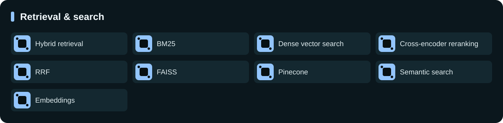

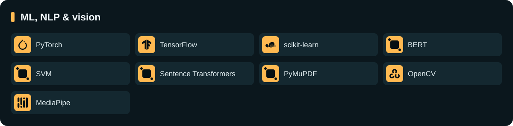

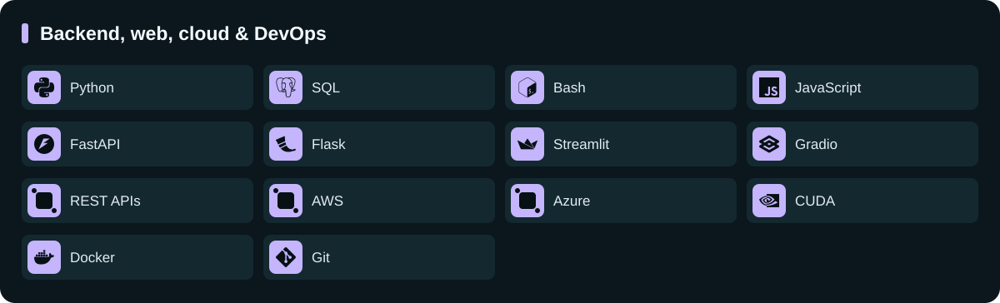

---

## `03 /` Education


[Queen Mary University of London](https://www.qmul.ac.uk/) · [Symbiosis University of Applied Sciences](https://www.suas.ac.in/)

---

## `04 /` Build log · Recent updates

A running log of what I’ve been working on, using my own commit messages from my public repositories. Each entry links to the change behind the update.

<!-- RECENT-COMMITS:START -->
- **2026-10-29** — Align profile focus with resume: remove fine-tuning claim, match project focus · [shreyshrivastava](https://github.com/shreyshrivastava/shreyshrivastava) · [view commit](https://github.com/shreyshrivastava/shreyshrivastava/commit/6327d2c091de65234eb98cf4247d0d91c8e88e89)
- **2026-10-29** — Update README.md · [bhopal-crime-safety-intelligence](https://github.com/shreyshrivastava/bhopal-crime-safety-intelligence) · [view commit](https://github.com/shreyshrivastava/bhopal-crime-safety-intelligence/commit/9fa61d78761957bef7ebf955580af1a62bdcb0b2)
- **2026-10-29** — Remove current snapshot information from README · [bhopal-crime-safety-intelligence](https://github.com/shreyshrivastava/bhopal-crime-safety-intelligence) · [view commit](https://github.com/shreyshrivastava/bhopal-crime-safety-intelligence/commit/d9e4ee47ae91fec69b7cb8ade0c0a27a1ce51f4f)
- **2026-10-29** — Describe Bhopal Safety Intelligence with reviewed official data · [shreyshrivastava](https://github.com/shreyshrivastava/shreyshrivastava) · [view commit](https://github.com/shreyshrivastava/shreyshrivastava/commit/4704a8abf42d5ea7f4197b142a9a8f87b13bc70e)
- **2026-10-26** — Refresh official sources daily at midnight IST with review queue · [bhopal-crime-safety-intelligence](https://github.com/shreyshrivastava/bhopal-crime-safety-intelligence) · [view commit](https://github.com/shreyshrivastava/bhopal-crime-safety-intelligence/commit/f9f85aa5781075d7218e138092ebe8bc84eaac4a)
<!-- RECENT-COMMITS:END -->

### Active repositories

<!-- RECENT-REPOS:START -->
- [AcademicForge](https://github.com/shreyshrivastava/AcademicForge) — Hackathon research assistant with paper search, summaries, guidance, and a cost-controlled Streamlit demo with request limiting.
- [shreyshrivastava](https://github.com/shreyshrivastava/shreyshrivastava) — Config files for my GitHub profile.
- [bhopal-crime-safety-intelligence](https://github.com/shreyshrivastava/bhopal-crime-safety-intelligence) — Interactive geospatial crime mapping, police proximity analysis, and civic safety intelligence dashboard for Bhopal, MP
- [shreyshrivastava.github.io](https://github.com/shreyshrivastava/shreyshrivastava.github.io) — Explore the repository and its latest changes.
- [ats-resume-checker](https://github.com/shreyshrivastava/ats-resume-checker) — ATS resume checker with deterministic resume-job scoring, PDF extraction, report downloads, and optional local Gemma 3 explanations.
<!-- RECENT-REPOS:END -->

---

Activity refreshes hourly through <a href=".github/workflows/update-readme.yml">GitHub Actions</a>, and can also be refreshed manually from the Actions tab. Commit updates use GitHub’s search index, so new commits may take a little time to appear. Only public repositories and commits attributed to my GitHub account are included.

<a href="https://shreyshrivastava.com/contact.html"></a>
